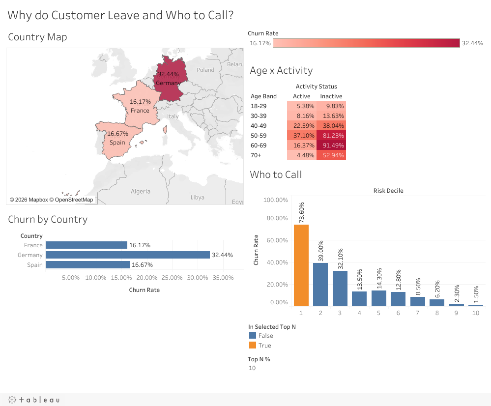

# Bank Customer Churn Analysis (SQL, Excel, Tableau)

Finding which bank customers are about to leave, and showing whether calling them pays off.

[](https://public.tableau.com/app/profile/vimarsh.neekanahalli.mahesh/viz/BankCustomerChurnWhyCustomersLeave/ChurnOverview)

*Interactive version on [Tableau Public](https://public.tableau.com/app/profile/vimarsh.neekanahalli.mahesh/viz/BankCustomerChurnWhyCustomersLeave/ChurnOverview).*

## Headline results

| | |
|---|---|
| **Churn** | 2,038 of 10,000 customers left - **20.38%** |
| **Money lost** | **$185.7M - 24.28% of all deposits** (leavers held larger balances) |
| **Biggest drivers** | Age 50-59 + inactive: **81.23%** churn, Germany: **32.44%** (2x France/Spain), one product: **27.71%** vs two: **7.60%** |
| **Risk score (test set)** | Riskiest 10% churn at **73.33%** - **3.63x lift** - capturing **36.36%** of all leavers |
| **Money at risk** | The top 10% hold 14.94% of deposits but **44.82%** of deposits lost |
| **Business case** | Calling the top 10% breaks even at a **1.10% save rate** (~1 in 90 would-be leavers, using assumed costs) |

Risk-score figures are measured on a held-out **test set** of customers the score
never saw. ROI figures use clearly labelled assumptions.

## The business question

A retail bank (10,000 customers in France, Germany and Spain) wants its retention
team to call the **riskiest 10% of customers each month**. Who should be on the
list, how much money is at stake, and does the campaign pay for itself?

## Tools

| Tool | What it does in this project |
|---|---|
| **SQL (SQLite)** | Normalised schema with PK/FK/CHECK constraints, 15 automated data-quality checks, leakage review, indexes and `EXPLAIN QUERY PLAN`, CTEs, `CASE`, `GROUP BY/HAVING`, range joins, window functions (`RANK`, `NTILE`, running totals, a window-function median), rule-based risk score with a reproducible build/test split, ROI model |
| **Excel** | Live-formula workbook: KPIs reconciled to SQL with a check column (`COUNTIFS`, `AVERAGEIFS`, `SUMIFS`, `XLOOKUP`), dynamic-array call list (`LET`, `FILTER`, `SORT`, `UNIQUE`, `XMATCH`, `SEQUENCE`), ROI scenario driven by named input cells, country dropdown |
| **Tableau** | Interactive story: calculated fields (churn rate, deposits lost), a **Top N %** parameter driving the call-list chart, filled country map, age x activity heatmap, a dashboard where the map filters the other views, and a 5-point Story |

Python is used only to build the Excel file and time the benchmarks; all analysis
logic lives in SQL, Excel formulas and Tableau calculations.

## Dashboard

**Tableau Public:** [Bank Customer Churn - Why Customers Leave](https://public.tableau.com/app/profile/vimarsh.neekanahalli.mahesh/viz/BankCustomerChurnWhyCustomersLeave/ChurnOverview)

## Key findings

1. **Middle age + inactivity.** Churn peaks at 56.04% for ages 50-59; inactive 50-59s
   leave 81.23% of the time. Inactive members are 63.94% of all leavers.
2. **Two products is the sweet spot.** 7.60% churn with two products vs 27.71% with
   one; customers with 3-4 products leave 82.71-100% of the time.
3. **Germany is the hot spot.** 32.44% churn, and 52.76% of all deposits lost.
4. **Leavers are wealthier.** Average balance $91,109 vs $72,743 for stayers - the
   bank loses 24.28% of deposits from 20.38% of customers.
5. **What doesn't matter:** credit score, tenure, credit-card ownership and salary
   barely move churn.

Full write-ups: [churn report](reports/churn_report.md) ,
[executive summary](reports/executive_summary.md) ,
[data quality & leakage](reports/data_quality.md) ,
[risk score](reports/risk_score.md), [money at risk & ROI](reports/money_at_risk_roi.md)

## Approach

1. **Database design** - raw CSV -> exact staging copy -> three typed tables
   (`customers`, `accounts`, `activity`) joined on `customer_id`.
2. **Data quality** - completeness, duplicates, ranges, class balance and a
   **leakage review**: `complained` matched churn in 99.86% of rows, so it was
   excluded from the score.
3. **Automated checks** - 15 queries that return zero rows when the data is
   healthy, each tested against an injected fault.
4. **Performance** - indexes chosen from the query plans; 1.5-2.9x faster on key queries.
5. **Analysis** - churn by attribute, combined segments, financial comparisons,
   within-country rankings.
6. **Risk score** - 70/30 split by the last digit of the customer ID; points derived
   on the build set only (10 x log-lift, smoothed), checked on the test set.
7. **Money at risk & ROI** - deposits by risk tier; campaign cost-benefit with
   every input flagged as an assumption.
8. **One source of truth** - Excel and Tableau read the same SQL extracts and
   reconcile to it ([reconciliation](docs/reconciliation.md)).

## Project structure

- `data/raw/`: original CSV (read-only)
- `data/extracts/`: star-schema CSVs for Excel and Tableau
- `sql/`: 00-18, schema, transform, checks, analysis, score, ROI, extracts
- `scripts/`: build_db.sh, run_checks.sh, export_extracts.sh, build_excel.py
- `excel/`: churn_analysis.xlsx
- `reports/`: churn report, executive summary, data quality, risk score, ROI
- `docs/`: data dictionary, performance, reconciliation, dashboard image

## How to rerun

Requirements: `sqlite3` (3.35+), Python 3 with `openpyxl` (only for the Excel build),
Excel 2021 / Microsoft 365.

```bash
./scripts/build_db.sh          # raw CSV -> data/churn.db (tables, indexes, bands, risk score)
./scripts/run_checks.sh        # 15 validation checks; prints PASS or the failing rows
./scripts/export_extracts.sh   # data/extracts/*.csv
python3 scripts/build_excel.py # excel/churn_analysis.xlsx
```

Any analysis file can then be run on its own, e.g.
`sqlite3 -header -column data/churn.db ".read sql/08_churn_by_attribute.sql"`.
Optional: `./scripts/explain_plans.sh` (query plans), `python3 scripts/benchmark_indexes.py`.

## Limitations

One snapshot (no dates), so the score ranks resemblance to past leavers rather than
forecasting a date; ROI inputs are assumptions and exclude offer costs; product
counts of 3-4 may partly reflect the exit itself; the data is a public dataset.
Details in the [churn report](reports/churn_report.md#9-limitations).

## Data

[Bank Customer Churn](https://www.kaggle.com/datasets/radheshyamkollipara/bank-customer-churn)
(Kaggle, public) - `Customer-Churn-Records.csv`, 10,000 customers, 18 columns.
Column definitions: [data dictionary](docs/data_dictionary.md).
